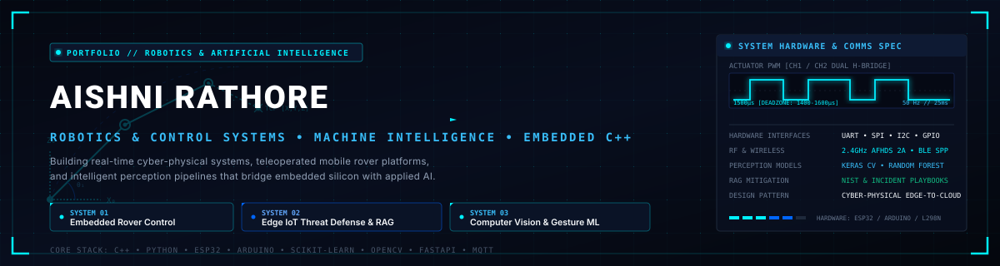
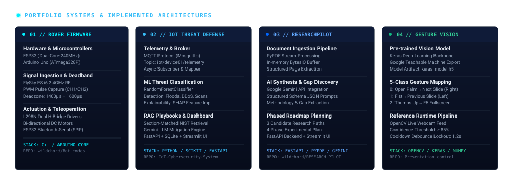
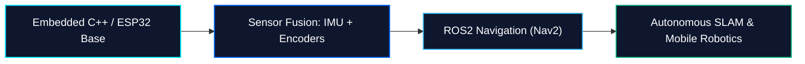

<div align="center">



<br/><br/>

[](https://github.com/wildchord)
[](https://github.com/wildchord)
[](https://github.com/wildchord)

<br/>

### `AISHNI RATHORE`
**Robotics & Artificial Intelligence Engineering Student**  
*Designing embedded rover control systems, embedded microcontroller firmware, and intelligent cyber-physical systems.*

---

</div>

## 🛰️ System Overview

I am an engineering student focused on the intersection of **embedded robotics**, **microcontroller firmware**, and **applied artificial intelligence**. My projects center on building physical cyber-physical systems — from writing low-level motor control firmware on microcontrollers to deploying edge machine learning pipelines that process telemetry and sensor data streams.

```
┌────────────────────────────────────────────────────────────────────────┐
│                        CORE ENGINEERING DIRECTIVE                      │
├────────────────────────────────────────────────────────────────────────┤
│  "Bridge low-level hardware actuation with high-level intelligence:    │
│   microcontroller-based motor control, resilient telemetry, and ML."   │
└────────────────────────────────────────────────────────────────────────┘
```

- 🔬 **Core Domains:** Embedded Robotics & Rover Control, Microcontroller Firmware, Computer Vision, Edge ML, Cyber-Physical Telemetry
- 🛠️ **Practical Implementation:** Bare-metal microcontroller programming, RF pulse decoding, motor driver interfacing, and full-stack telemetry dashboards
- 📡 **Communications & Telemetry:** 2.4GHz RF (AFHDS 2A), Bluetooth Serial (SPP), MQTT pub/sub, UART/I2C/SPI buses

---

## ⚡ Technical Architecture

<div align="center">
  
</div>

<br/>

### Implemented Technical Competencies

The following technical stack reflects practical systems and codebases implemented across my repositories:

| Engineering Domain | Frameworks & Tools | Concrete Practical Applications |
| :--- | :--- | :--- |
| **Robotics & Embedded Systems** | C++, Arduino Core, ESP32, Arduino Uno, L298N H-Bridge, FlySky FS-i6 RC | Microsecond PWM pulse decoding (`pulseIn()`), deadband thresholding (`1400μs–1600μs`), H-bridge motor direction control, proportional PWM throttle mapping |
| **Edge AI & Machine Learning** | Python, Scikit-Learn, Random Forest, Keras, NumPy, Pandas, SHAP | Supervised classification, feature mapping, network traffic anomaly detection, model explainability |
| **Computer Vision & Perception** | OpenCV, Teachable Machine, Keras (`.h5`), Video Stream Processing | Hand gesture classification, pre-trained model inference, computer vision feature evaluation |
| **Cyber-Physical & Telemetry** | MQTT Broker, Bluetooth Serial (SPP), UART, REST APIs, SQLite | Edge-to-server sensor telemetry streaming, IoT intrusion detection, RAG-guided NIST incident mitigation |
| **Software Architecture & Tooling** | Linux, Git, FastAPI, Streamlit, Pytest | Modular service architecture, automated unit verification, RESTful API design, interactive engineering dashboards |

---

## 🚀 Featured Engineering Projects

### 01. Embedded Robotics & Rover Control Systems
> **Hardware:** ESP32, Arduino Uno, L298N Dual H-Bridge Drivers, FlySky FS-i6 6-Ch 2.4GHz Receiver, Bluetooth Module  
> **Software:** Embedded C++ / Arduino Firmware, ESP32 BluetoothSerial  
> **Source:** [`Bot_codes`](https://github.com/wildchord/Bot_codes) *(Rover Control Firmware)*

A suite of embedded firmware implementations for physical mobile rovers engineered for wireless teleoperation, RF signal processing, and motor driver actuation:
- **FlySky 2.4GHz RF Pulse Decoding:** Implemented microsecond-level pulse-width measurement across steering (`CH1`) and throttle (`CH2`) channels with a calibrated deadzone buffer (`1400μs – 1600μs`) to eliminate motor stall whine and mechanical drift.
- **Dual H-Bridge Motor Control:** Programmed bi-directional driver signals via L298N logic for forward, reverse, and differential steering.
- **ESP32 Bluetooth Serial (SPP) Telemetry:** Developed an embedded serial parser enabling mobile control and telemetry broadcast over wireless RF.

---

### 02. AI-Powered IoT Cybersecurity & Cyber-Physical Threat Detection
> **Architecture:** ESP32 Edge Sensor Telemetry + MQTT + Machine Learning + RAG + FastAPI + Streamlit  
> **Stack:** Python, Scikit-Learn, Random Forest, SQLite, Google Gemini API, Pytest  
> **Source:** [`AI-Powered-IoT-Cybersecurity-Threat-Detection-System`](https://github.com/wildchord/AI-Powered-IoT-Cybersecurity-Threat-Detection-System)

A full-stack, end-to-end security pipeline for cyber-physical IoT networks:
- **Edge Telemetry Streaming:** Collects network and hardware telemetry streamed from edge nodes over an MQTT pub/sub broker (`iot/device01/telemetry`).
- **Intrusion Detection Classifier:** Implemented Random Forest models to identify network anomalies (DDoS, ICMP floods, TCP/UDP packet floods, unauthorized port sweeps).
- **RAG Knowledge Mitigation Engine:** Integrated a Retrieval-Augmented Generation module referencing structured NIST security guidelines to generate actionable incident response protocols upon attack classification.
- **Live Command Dashboard:** Features a Streamlit telemetry UI backed by FastAPI REST services and SQLite persistent event logging.

---

### 03. ResearchPilot — AI-Powered Academic Research Assistant
> **Stack:** Python, FastAPI, Streamlit, PyPDF, Google Gemini API, Pytest  
> **Source:** [`RESEARCH_PILOT`](https://github.com/wildchord/RESEARCH_PILOT)

An intelligent research synthesis platform created to accelerate technical literature review and paper analysis:
- **Automated Paper Ingestion & Parsing:** Extracts structured technical information and metadata from academic PDF publications using `pypdf`.
- **Research Gap Discovery:** Synthesizes multi-publication analyses to highlight contradictory findings, unaddressed problems, and prospective research directions.
- **Interactive Research Planner:** Generates structured multi-phase research roadmaps and hypothesis validation workflows.

---

### 04. Computer Vision Gesture Model & Controller Architecture
> **Artifacts:** Pre-trained Keras Model (`keras_model.h5`), Label Index (`labels.txt`), Teachable Machine Project  
> **Stack:** Python, Keras, TensorFlow, Teachable Machine  
> **Source:** [`ML-Project---Presentation_control`](https://github.com/wildchord/ML-Project---Presentation_control)

A vision-based deep learning classifier trained to recognize distinct hand gestures for hands-free presentation navigation:
- **Trained 5-Class Vision Model:** Trained and exported a MobileNet-backed Keras model recognizing five gesture classes (`Open Palm`, `Fist`, `Thumbs Up`, `Thumbs Down`, `No Gesture`).
- **Navigation Architecture:** Formulated an interface architecture and reference implementation mapping recognized gestures to slide navigation commands with confidence thresholds and cooldown lockout.

---

## 📈 Software Engineering Foundations

Beyond robotics and AI systems, I maintain a disciplined software engineering practice focusing on data structures, modular systems architecture, and automated testing:

- [`Project03-contact_manager`](https://github.com/wildchord/Project03-contact_manager) — CLI application demonstrating strict input schema validation, JSON data persistence, and automated pytest test suites.
- [`Project4-Personal_Finance_Tracker`](https://github.com/wildchord/Project4-Personal_Finance_Tracker) — Modular data modeling engine featuring persistent JSON storage, automated backup/restore cycles, and CSV reporting.
- [`Problem-Solving-with-Algorithms-and-Data-Structures-Using-Python`](https://github.com/wildchord/Problem-Solving-with-Algorithms-and-Data-Structures-Using-Python) — Algorithmic problem-solving covering time/space complexity analysis, recursion trees, and fundamental data structures.

---

## 🔬 Active Learning & Prospective Research Interests

The following areas represent active study and technical roadmaps currently being explored:



- [ ] **ROS2 & micro-ROS:** Integrating micro-ROS on ESP32 microcontrollers for native ROS2 node publish/subscribe communication.
- [ ] **State Estimation:** Implementing Extended Kalman Filters (EKF) combining 6-axis IMU acceleration/gyro data with optical wheel encoders.
- [ ] **Edge Vision Inference:** Exploring model quantization (INT8 / TensorFlow Lite for Microcontrollers) for on-chip object detection.

---

## 📊 Development Activity & Repositories

```
┌────────────────────────────────────────────────────────────────────────┐
│                        GITHUB REPOSITORY SUMMARY                       │
├────────────────────────────────────────────────────────────────────────┤
│  • Focus Domains:       Rover Control, Edge AI, IoT Threat Defense     │
│  • Primary Languages:   C++, Python, Embedded C                        │
│  • Architecture Focus:  Microcontroller Firmware & Applied AI Systems  │
│  • Activity Graph:      View native GitHub contribution matrix below   │
└────────────────────────────────────────────────────────────────────────┘
```

*(Refer to the native GitHub contribution calendar and repository commit histories on this profile for detailed commit timestamps, branches, and code revisions.)*

---

## 📡 Contact & Networking

<div align="center">

[](https://github.com/wildchord)
&nbsp;
[](mailto:rathoreaishni@gmail.com)

<br/>

```
[COMMUNICATION]: Open for Robotics & AI Engineering Internships, Control Systems Projects, & Research Collaborations.
```

</div>

## Hi there 👋

<!--
**wildchord/wildchord** is a ✨ _special_ ✨ repository because its `README.md` (this file) appears on your GitHub profile.

Here are some ideas to get you started:

- 🔭 I’m currently working on ...
- 🌱 I’m currently learning ...
- 👯 I’m looking to collaborate on ...
- 🤔 I’m looking for help with ...
- 💬 Ask me about ...
- 📫 How to reach me: ...
- 😄 Pronouns: ...
- ⚡ Fun fact: ...
-->

